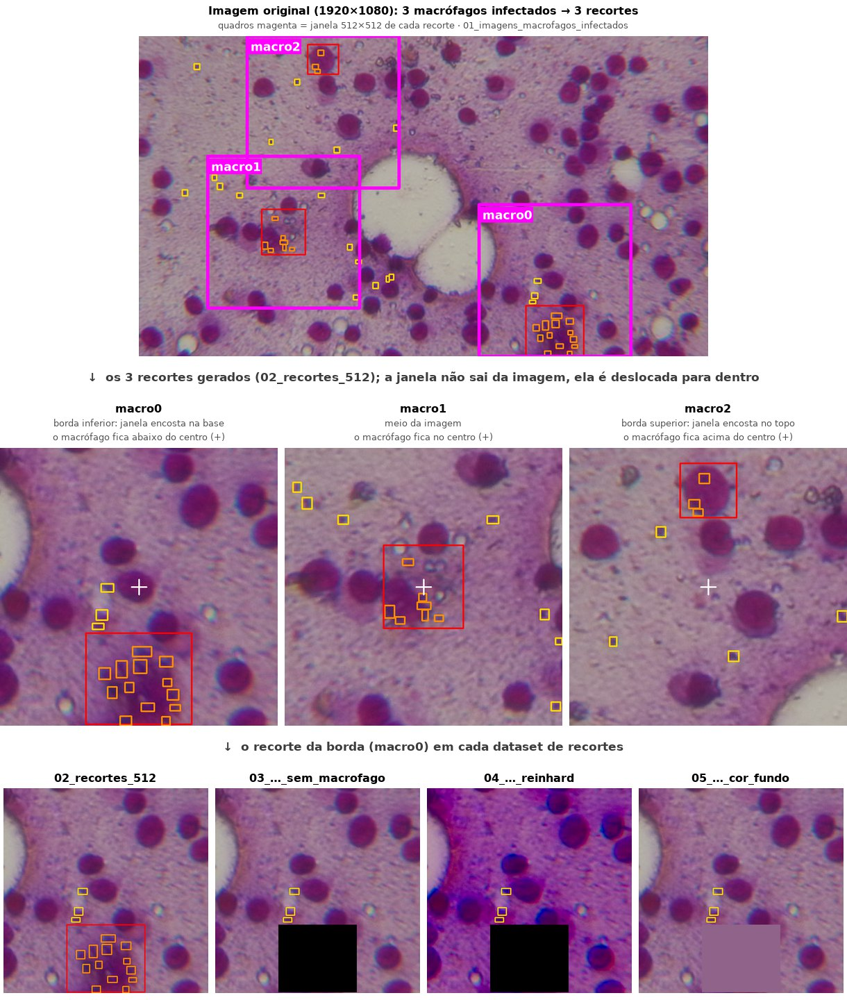

# Detecção de amastigotas de *Leishmania* fora do macrófago

Projeto de doutorado de Clésio Gonçalves. Este trabalho detecta, com YOLO, as amastigotas de *Leishmania* que estão **fora** dos macrófagos, em imagens de microscopia de lâminas coradas. É a etapa 5 do pipeline do grupo:

```
Rafael: detecta e recorta os macrófagos → Vivi: filtra os falsos positivos → Emily: classifica infectado / não infectado
        → Armando: conta as amastigotas dentro do macrófago → Clésio: conta as amastigotas fora do macrófago
```



## Principais resultados

Os resultados são de 14 experimentos, com validação cruzada de 6 folds separados por lâmina. As métricas são do conjunto de teste, em média ± desvio padrão entre os folds.

1. **Mascarar a região do macrófago foi a única mudança que ajudou de forma clara.** O mAP50 subiu de 0,39–0,44 (exp01–07) para 0,485–0,496 (exp08–14). A máscara tira a confusão entre a amastigota de dentro e a de fora do macrófago.
2. **O tamanho e a arquitetura do modelo não importaram.** Do YOLO11n (2,6M de parâmetros) ao YOLOv8l (43,6M), passando por YOLO26 e cabeça P2, todos ficaram no mesmo patamar. O **YOLO11n** treina cerca de 5× mais rápido e é o melhor custo-benefício.
3. **O pré-processamento sobre o recorte mascarado não mudou a média (exp11–14).** Testamos normalização de cor (Reinhard), aumento de cor HED, máscara com a cor do fundo e imgsz 1024. Todos ficaram dentro do ruído, entre +0,002 e +0,011 em relação ao exp08.
4. **O limitante principal são os dados.** A variação entre folds (~0,10–0,15) é maior que qualquer ganho obtido. A `leish_4` e a `leish_3` são sempre as piores lâminas, e a `leish_7` sempre a melhor.

**Melhor configuração até aqui:** recorte 512×512 com o macrófago mascarado + YOLO11n, imgsz 512, AdamW, lr0 5e-4, cos_lr, 150 épocas, patience 40 e aumento de dados (hsv 0.03/0.9/0.6, degrees 15, flipud 0.5, mixup 0.1).

| Exp. | Configuração | Entrada | Precisão | Recall | mAP50 | mAP50-95 |
|---|---|---|---|---|---|---|
| 01 | YOLO11n | macrófago visível | 0,474 ± 0,116 | 0,501 ± 0,078 | 0,439 ± 0,123 | 0,170 ± 0,046 |
| 02 | YOLO11n + cabeça P2, imgsz 640 | macrófago visível | 0,467 ± 0,098 | 0,492 ± 0,076 | 0,423 ± 0,108 | 0,164 ± 0,041 |
| 03 | YOLO11l | macrófago visível | 0,452 ± 0,095 | 0,483 ± 0,086 | 0,405 ± 0,110 | 0,158 ± 0,039 |
| 04 | YOLO26m | macrófago visível | 0,460 ± 0,108 | 0,489 ± 0,057 | 0,427 ± 0,107 | 0,166 ± 0,040 |
| 05 | YOLO26l | macrófago visível | 0,444 ± 0,095 | 0,463 ± 0,071 | 0,394 ± 0,100 | 0,154 ± 0,042 |
| 06 | YOLO11m + CLAHE + aumento de dados | macrófago visível | 0,458 ± 0,113 | 0,517 ± 0,065 | 0,435 ± 0,118 | 0,167 ± 0,039 |
| 07 | YOLO11l + Lab + batch 4 | macrófago visível | 0,449 ± 0,121 | 0,490 ± 0,071 | 0,407 ± 0,118 | 0,148 ± 0,041 |
| 08 | **YOLO11n** | **mascarado** | 0,508 ± 0,102 | 0,547 ± 0,074 | 0,485 ± 0,109 | 0,184 ± 0,039 |
| 09 | YOLO11l | mascarado | 0,510 ± 0,136 | 0,551 ± 0,100 | 0,493 ± 0,152 | 0,192 ± 0,059 |
| 10 | YOLOv8l | mascarado | 0,503 ± 0,103 | 0,549 ± 0,066 | 0,489 ± 0,107 | 0,188 ± 0,038 |
| 11 | YOLO11n + cor normalizada (Reinhard) | mascarado | 0,498 ± 0,118 | 0,560 ± 0,072 | 0,492 ± 0,121 | 0,189 ± 0,041 |
| 12 | YOLO11n + aumento de cor HED | mascarado | 0,514 ± 0,110 | 0,555 ± 0,075 | **0,496 ± 0,124** | 0,190 ± 0,042 |
| 13 | YOLO11n, máscara com a cor do fundo | mascarado (cor do fundo) | 0,506 ± 0,121 | 0,550 ± 0,099 | 0,488 ± 0,130 | 0,187 ± 0,047 |
| 14 | YOLO11n, imgsz 1024 | mascarado | 0,505 ± 0,128 | 0,554 ± 0,084 | 0,489 ± 0,134 | **0,199 ± 0,052** |

Diferenças menores que ~0,03 de mAP50 estão dentro do ruído entre folds.

**Ressalvas**
- No **exp09**, o fold 1 foi interrompido na época 100 de 150, e a melhor época do fold 6 foi a 5. O exp10 terminou todos os folds e confirmou o mesmo patamar.
- O cabeçalho do notebook do **exp03** é uma cópia do exp01. Os números válidos são os desta tabela.

## Dados e protocolo

- **Dados brutos:** 8 lâminas (`leish_1`, 2, 3, 4, 5, 7, 8, 9) anotadas no CVAT, com 609 imagens de 1920×1080. As classes são `Non-macrophages` (sem anotações), `macrophage`, `leishmania` (o alvo, fora do macrófago) e `inside-macrophage` (amastigota dentro do macrófago, não detectada).
- **Entrada dos modelos:** recortes de 512×512 centrados em cada macrófago infectado, 1.568 no total. As anotações são reduzidas a uma única classe, `leishmania`.
- **Validação:** 6 folds separados por lâmina, com 5 lâminas de treino, 1 de validação e 2 de teste. A divisão é a mesma em todos os experimentos.

| Fold | Treino | Validação | Teste |
|---|---|---|---|
| 1 | leish_1, 2, 7, 8, 9 | leish_4 | leish_3, leish_5 |
| 2 | leish_1, 3, 4, 5, 9 | leish_8 | leish_2, leish_7 |
| 3 | leish_2, 3, 4, 5, 7 | leish_9 | leish_1, leish_8 |
| 4 | leish_1, 2, 3, 5, 8 | leish_7 | leish_4, leish_9 |
| 5 | leish_3, 4, 5, 8, 9 | leish_2 | leish_1, leish_7 |
| 6 | leish_3, 4, 5, 7, 9 | leish_1 | leish_2, leish_8 |

| | leish_1 | leish_2 | leish_3 | leish_4 | leish_5 | leish_7 | leish_8 | leish_9 |
|---|---|---|---|---|---|---|---|---|
| Recortes | 96 | 127 | 17 | 126 | 361 | 280 | 353 | 208 |
| Leishmanias fora do macrófago | 831 | 642 | **10** | **132** | 4.725 | 2.283 | 992 | 1.073 |

## Organização do repositório

```
├── README.md                     esta página
├── resumo_experimentos.html      resumo completo: gráficos, mapa de calor por lâmina, conclusões
├── atualizar_menu.py             refaz a barra de menu das páginas HTML
├── 00_dataset_cvat/              dados brutos do CVAT (só o README no git)
├── 01_preprocessamento/          notebooks 01–05 que geram os datasets
├── 02_datasets_derivados/        datasets gerados (só os READMEs e as figuras no git)
├── 03_experimentos anteriores/   exp01–exp09: notebook, README e métricas de cada um
├── 04_teste_gpu/                 notebook que verifica a GPU
└── 05_novos_experimentos/        exp10 em diante, executar_fila.sh
```

A documentação detalhada está em HTML, com uma barra de menu para navegar entre as páginas. **Abra os arquivos localmente no navegador**, porque o GitHub mostra HTML como código-fonte.

| Página | Conteúdo |
|---|---|
| [`resumo_experimentos.html`](resumo_experimentos.html) | Referência central: resultados, gráficos, mapa de calor por lâmina e conclusões |
| [`01_preprocessamento/README.html`](01_preprocessamento/README.html) | Fluxograma com imagens de exemplo e o que cada notebook faz |
| [`02_datasets_derivados/README.html`](02_datasets_derivados/README.html) | Os datasets gerados, com exemplos |
| [`03_experimentos anteriores/README.html`](03_experimentos%20anteriores/README.html) | Índice dos exp01–09 |
| [`05_novos_experimentos/README.html`](05_novos_experimentos/README.html) | Índice, status e plano dos exp10 em diante |

Cada experimento tem um `README.html` na própria pasta, com objetivo, explicação da técnica, imagens de entrada, resultado por fold e por lâmina e ressalvas.

## O que não está no repositório

Para manter o repositório pequeno (~165 MB), o `.gitignore` deixa de fora:

- **dados brutos** (`00_dataset_cvat/`, 2,7 GB), que estão guardados à parte;
- **datasets derivados** (`02_datasets_derivados/*/`, 2,9 GB), que são regerados pelos notebooks de `01_preprocessamento/`;
- **pesos dos modelos** (`*.pt`, 5,7 GB);
- **estrutura YOLO dos folds** (`folds_yolo/`), que é recriada por cada notebook de experimento;
- **gráficos e imagens de batch** dos treinos (`runs/**/*.png|jpg`). Ficam no repositório o `results.csv`, o `args.yaml` e o `concluido.txt` de cada fold.

## Como reproduzir

**Ambiente usado:** Python 3.13.9, Ultralytics 8.4.75, PyTorch 2.12.1 (CUDA 13), OpenCV 4.13, scikit-image 0.25, papermill 2.7, GPU NVIDIA RTX 5070 Ti (16 GB).

1. Coloque os zips exportados do CVAT (YOLO 1.1) em `00_dataset_cvat/`.
2. Rode os notebooks de `01_preprocessamento/` na ordem numérica (01 → 05). Eles geram os datasets em `02_datasets_derivados/`.
3. Rode o notebook do experimento, desligado do editor, para continuar mesmo se o VS Code fechar:
   ```bash
   cd 05_novos_experimentos/exp12_yolo11n_aumento_hed
   setsid nohup papermill -k python3 --cwd . exp12_yolo11n_aumento_hed.ipynb exp12_yolo11n_aumento_hed.ipynb > execucao.log 2>&1 &
   ```
   Para rodar vários em sequência: `./executar_fila.sh exp11_… exp12_…` (o andamento fica em `fila.log`).

Os caminhos dos notebooks partem de `diretorio_raiz = Path("/mnt/arquivos/Doutorado")`. Ajuste esse caminho se o projeto estiver em outra pasta. Os notebooks dos exp01–09 ainda usam nomes de pasta antigos; a correspondência com os nomes atuais está em `02_datasets_derivados/README.html`.

## Pendências

- Avaliação binária por lâmina ou recorte (encontrou ou não leishmania), pedida na reunião de 10 ago. 2026.
- Teste com imagens inteiras, em 640 e 1080.
- Detecção restrita a um raio em torno dos macrófagos infectados retornados pelo algoritmo da Emily.
- Usar na máscara as caixas **previstas** pelo detector de macrófagos, e não as anotadas.
